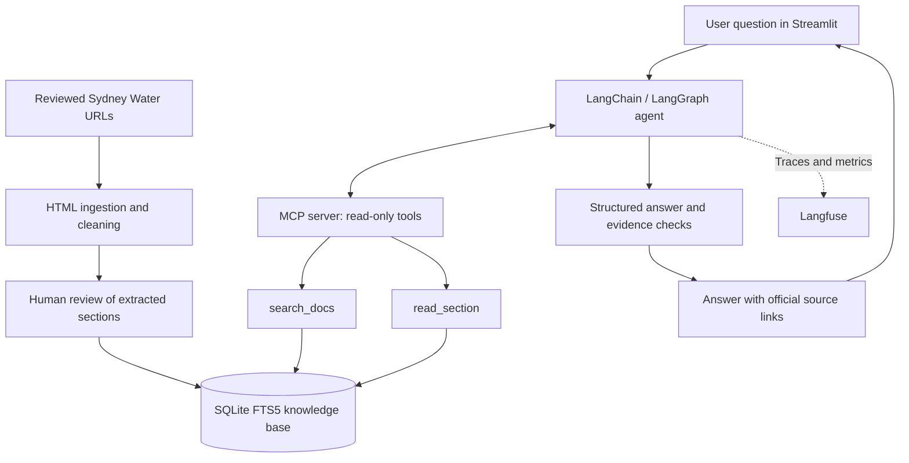

# Sydney Water Student Assistant

An independent student proof of concept that uses an AI agent to answer questions about publicly available Sydney Water information.

The aim is to make it easier to find and understand information about **bills, payment options, payment assistance and account access**, without having to search through multiple pages of the website. The assistant uses a curated set of official Sydney Water pages and links back to the sources it uses.

> **Disclaimer:** This is a student project, not an official Sydney Water service. It cannot access customer accounts, make payments, check personal eligibility or provide live account information. Do not enter personal, account or payment details.

## What it does

- Answers public-information questions using reviewed Sydney Water website content.
- Uses a **single agent** that can choose when to search for information and when to read a full section for more detail.
- Supports follow-up questions within a conversation.
- Returns short answers with links to the official source pages.
- Applies input checks, tool limits and source validation to reduce unsupported responses.
- Shows basic execution details, including which retrieval tools were called.
- Supports **Langfuse** tracing for debugging and observing agent behaviour.

Example questions:

- *What does the usage charge mean?*
- *What ways can I pay my bill?*
- *My bill went up and I'm struggling to pay it. What options are available?*

## How it works



### 1. Building the knowledge base

The project starts with a manually selected list of Sydney Water URLs in `data/sources.json`. The ingestion script:

1. Downloads the allowed HTML pages using `httpx`.
2. Extracts the relevant content with BeautifulSoup, removing navigation and other page elements.
3. Splits the content into sections based on headings, keeping shorter excerpts for search.
4. Saves HTML snapshots and extracted sections for manual review.
5. Stores the content in a local SQLite database with an **FTS5 full-text search index**.

The database cannot be used by the assistant until the sources have been reviewed. Source reviews expire after 30 days, so the content needs to be checked again periodically.

### 2. Retrieving information through MCP

The agent connects to a local MCP server over **stdio**. The server exposes two read-only tools:

| Tool | Purpose |
| --- | --- |
| `search_docs` | Searches reviewed sections and returns ranked excerpts. |
| `read_section` | Retrieves the full text of a specific section when an excerpt is not enough. |

Retrieval uses **SQLite FTS5 with BM25 ranking**, Porter stemming and a small set of query synonyms. I chose this lightweight approach for a controlled collection of public pages rather than adding a vector database at this stage.

### 3. The agent

The assistant uses LangChain's `create_agent`, with LangGraph checkpointing to maintain the conversation state. Rather than always running one fixed search, the agent can decide to search again or read a fuller section when the question needs more evidence.

The workflow is deliberately limited to **one agent and two retrieval tools**. There are limits on model calls and tool calls per question, and the agent is instructed to say when the reviewed sources do not provide enough information.

Conversation memory is temporary and session-based. It is reset after 20 turns, 30 minutes of inactivity, or a change to the knowledge-base version or model configuration. This is not a persistent long-term memory system.

### 4. Answer validation and safety

The assistant is designed for public information only. It does not use private account data or perform transactions.

The implementation includes:

- Input checks intended to block personal, account and payment details.
- An allowlist restricting knowledge sources to approved Sydney Water URLs.
- Validation that cited evidence IDs were actually returned by the retrieval tools.
- Structured answer output and checks for unsafe content in responses.
- Fixed fallback messages for unsupported questions, insufficient evidence and execution failures.
- Limits on the number and duration of model and tool calls.

**Important limitation:** A valid citation reference means the source was retrieved and approved; it does not by itself prove that every sentence is supported by that source. Factual correctness still needs evaluation against the original pages.

## Technology stack

| Technology | Use |
| --- | --- |
| Python 3.12 | Backend implementation |
| Streamlit | Chat interface |
| LangChain + LangGraph | Agent, tools and conversation state |
| MCP | Read-only retrieval server |
| SQLite FTS5 | Local search index and BM25 retrieval |
| BeautifulSoup + HTTPX | Website content ingestion |
| Pydantic | Tool and answer schemas |
| Google Gemini / Groq integrations | LLM support in the project dependencies |
| Langfuse | Observability and tracing |
| Pytest | Tests |

## Running locally

### Requirements

- Python **3.12**
- The repository's `pyproject.toml`
- Access to a supported LLM provider and its API key
- A prepared `data/sources.json` file containing the reviewed source definitions

### 1. Install dependencies

```bash
python -m venv .venv
```

Activate the environment:

```bash
# Windows PowerShell
.venv\Scripts\Activate.ps1

# macOS / Linux
source .venv/bin/activate
```

Then install the project:

```bash
python -m pip install -e .
```

### 2. Configure the model

Create a `.env` file in the project root and add the relevant provider credentials and configuration. Do not commit this file to GitHub.

The supplied agent code currently has a provider-selection inconsistency in `model_client()`: both branches check `LLM_PROVIDER == "groq"`, and the first branch creates a Gemini client. **Fix and verify this function for your chosen provider before running the application.** The intended configuration cannot be reliably documented as working until that is resolved.

For Langfuse tracing, the code also looks for `LANGFUSE_PUBLIC_KEY` and `LANGFUSE_SECRET_KEY`. Tracing is optional.

### 3. Build and review the knowledge base

Ensure `data/sources.json` contains the approved source definitions, then run:

```bash
python knowledge.py ingest
```

Inspect the saved HTML snapshots in `data/snapshots/` and extracted sections in `data/review/`. After checking them against the original pages, mark the relevant sources as reviewed:

```bash
python knowledge.py review --ids SOURCE_ID_1 SOURCE_ID_2 --reviewer YOUR_NAME
```

Replace the example IDs with the actual IDs from `data/sources.json`. All indexed sources need a valid review before the assistant can serve answers.

Check the corpus status:

```bash
python knowledge.py status
```

### 4. Start the chatbot

```bash
streamlit run app.py
```

The Streamlit interface displays the answer, source links, and a small section explaining the tool calls and execution time. It also provides a **New conversation** button to clear the current session.

## Evaluation

I included an evaluation framework to test the chatbot rather than relying only on a few example questions.

`evaluate.py` is set up to compare two approaches using the same reviewed knowledge base:

- **Agentic retrieval:** The agent can decide whether to search, retrieve additional evidence or read full sections.
- **One-shot RAG baseline:** A single retrieval call followed by one structured model response, without an agent loop.

The evaluation covers **36 scenarios** in the configured test suite, including factual questions, compound questions, conversational follow-ups and safety cases. It records retrieval hit rate at 4, response-type matches, citation-reference checks, source coverage, model/tool calls, token usage and latency.

For example, to run the default smoke tests:

```bash
python evaluate.py --suite smoke --mode agent
```

The evaluation code also supports baseline runs, retrieval-only checks and generating a comparison report. Results are intended to be reviewed against the actual source material: **citation validity and response-type matches are not the same as factual accuracy**.

I am not including performance or accuracy claims here because verified evaluation results have not been provided.

## Project structure

```text
.
├── app.py                  # Streamlit interface
├── agent.py                # Agent workflow, boundaries and answer validation
├── knowledge.py            # Ingestion, review and SQLite retrieval
├── mcp_server.py           # Two read-only MCP tools
├── schemas.py              # Pydantic models for tools and answers
├── evaluate.py             # Agent vs one-shot RAG evaluation
├── test_system.py          # System tests (referenced in project config)
├── pyproject.toml          # Dependencies and project configuration
└── data/
    ├── sources.json       # Approved source manifest
    ├── knowledge.sqlite   # Generated local knowledge base
    ├── snapshots/         # Saved source HTML
    ├── review/            # Extracted sections for review
    └── eval_cases.jsonl   # Evaluation scenarios
```

Some files under `data/` are generated locally or must be supplied as part of the source-review process.

## Current limitations

This is an experimental student demo, not a customer-facing product. In particular:

- It only answers questions within its curated public-information scope.
- It cannot access account information, process payments or confirm a person's eligibility for assistance.
- It does not provide live updates or guarantee that the source pages are current between reviews.
- Its conversational memory is temporary, not a long-term user profile.
- Its reference checks do not replace human review of factual accuracy.
- Its provider configuration and end-to-end evaluation should be verified before presenting it as a fully working deployment.

## Why I built it this way

I wanted to explore how an AI agent could make official information easier to access while keeping its behaviour controlled and explainable. The challenge was not just getting an LLM to produce an answer, but making sure it uses the right information, shows where that information came from, and recognises when it cannot answer reliably.

I also wanted to see whether allowing an agent to choose its retrieval steps actually adds value compared with a simpler RAG pipeline. That is why the project includes both approaches and an evaluation framework to compare them.

---

**Independent student project.** Sydney Water is the source of the referenced public information and is not affiliated with or responsible for this demo.
